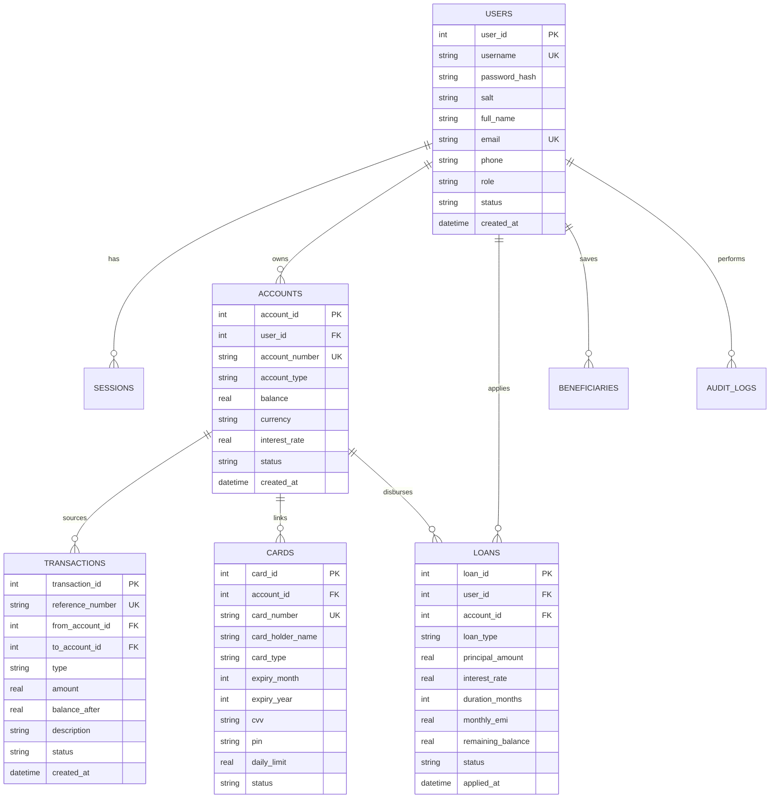

# 🏦 Apex National Bank — Banking Management System
### *Full-Stack Enterprise Banking Application (C++ Backend • SQLite Database • Modern Web Frontend)*

[](https://isocpp.org/)
[](https://www.sqlite.org/)
[](https://developer.mozilla.org/)
[]()
[]()

---

## 📌 Executive Summary

**Apex National Bank** is a complete, full-stack college-level **Banking Management System** engineered to provide enterprise-grade financial management, account operations, loan processing, virtual card controls, and role-based administrative governance.

The system combines:
1. **Frontend:** A responsive, dark-mode FinTech web portal crafted with vanilla HTML5, CSS3 variables, and modern JavaScript (ES6+).
2. **Backend:** A multi-threaded, high-performance REST API microservice built in **modern C++ (C++17)** utilizing `cpp-httplib` and `nlohmann/json`.
3. **Database:** An integrated **SQLite 3** relational database engine with foreign key enforcement, transaction integrity (ACID), prepared statements, and comprehensive audit trails.

---

## 🚀 Key Features

### 1. 🔐 Authentication & Role-Based Access Control (RBAC)
- **Multi-Role Architecture:** Dedicated workflows and permissions for **Customers**, **Branch Managers**, and **System Administrators**.
- **Cryptographic Security:** Passwords secured using **SHA-256** with randomized cryptographic salts.
- **Session Token Management:** Secure 24-hour expiration token generation with header, cookie, and query-param support.
- **One-Click Demo Switcher:** Interactive preset buttons to quickly test Customer, Manager, and Admin accounts without manual typing.

### 2. 💳 Account Management
- Multiple account tiers: **Everyday Checking**, **High-Yield Savings** (4.25% APY), **Fixed Deposits** (6.50% APY), and **Business Checking**.
- Automated 12-digit account number generator (`1001XXXXXXXX`).
- Account status lifecycle: `ACTIVE`, `FROZEN`, and `CLOSED`.
- Instant customer self-service opening of additional accounts.

### 3. 💸 Transaction Processing & ACID Safety
- **Deposit Simulation:** Immediate credit of cash/funds with real-time balance update.
- **ATM Withdrawal:** Debit capability with automated overdraft prevention.
- **Wire & Fund Transfer:** Atomic cross-account transfers with recipient account verification (displays verified recipient name before sending) and rollback protection.
- **Searchable Ledger & Statements:** Filter by date, category, and reference ID; exportable to **CSV** and printable.

### 4. 📑 Loan & Credit Management System
- Multiple loan categories: **Personal**, **Home Mortgage**, **Education / Student**, **Auto / Vehicle**, and **Business**.
- **Amortization EMI Engine:** Mathematical formula:
  $$\text{EMI} = \frac{P \cdot r \cdot (1 + r)^n}{(1 + r)^n - 1}$$
- **Manager Approval Workflow:** Applications submitted to branch manager queue for approval or rejection.
- **Automated Disbursement:** Approved loans disburse funds directly into the applicant's linked bank account.
- **Installment Repayments:** Customers can pay monthly installments or pay off remaining debt.

### 5. 🛡️ Virtual Cards & Security Controls
- Interactive virtual debit and credit card rendering (holographic gradients, chip, cardholder name, expiry date).
- **Show/Hide Security Toggle:** Card number and CVV reveal controls.
- **Instant Card Freeze / Lock:** One-click card freezing to prevent unauthorized use.
- **Daily Spending Limit Configuration:** Adjust daily transaction caps on the fly.

### 6. 👥 Beneficiary / Payee Directory
- Save frequently used payees with routing codes and nicknames.
- 1-click quick-send transfer integration.

### 7. 🧮 Interactive Financial Calculator
- Real-time interactive sliders for Loan Principal, Interest Rate, and Tenure.
- Instant computation of Monthly EMI, Total Interest, and Total Payable.

### 8. 👔 Branch Manager Console
- Queue of pending customer loan applications.
- Review modal with Approve/Reject decisions and feedback notes.
- Customer account freeze/unfreeze controls.

### 9. ⚙️ System Administrator Dashboard
- Real-time KPI metrics: total registered users, active accounts, vault deposit reserves, and system transaction volume.
- User directory with account status toggling (Activate / Suspend).
- Create new Customer, Manager, or Admin users.
- Live Security Audit Log viewer tracking user actions, timestamps, and IP addresses.

---

## 📁 Project Directory Structure

```
Antigravittty/
│
├── backend/                        # C++ Backend Service
│   ├── include/                    # Header files
│   │   ├── auth.h                  # Authentication & session interfaces
│   │   ├── controllers.h           # REST API endpoint route definitions
│   │   ├── database.h              # SQLite database manager & queries
│   │   ├── models.h                # C++ structs & JSON serialization
│   │   ├── sha256.h                # Self-contained SHA-256 implementation
│   │   └── utils.h                 # Financial math, tokens, formatting
│   ├── src/                        # C++ Implementation
│   │   ├── auth.cpp                # Authentication logic & password hashing
│   │   ├── controllers.cpp         # Route controllers & JSON responses
│   │   ├── database.cpp            # SQLite database queries & ACID transactions
│   │   └── main.cpp                # HTTP server startup & static asset mount
│   └── build.bat                   # Secondary build script
│
├── database/                       # Relational Database
│   ├── schema.sql                  # Complete SQLite relational DDL schema
│   ├── seed.sql                    # Initial seed dataset with demo accounts
│   └── bank.db                     # SQLite database file (auto-generated)
│
├── frontend/                       # Modern FinTech Web Interface
│   ├── index.html                  # Single Page Application (SPA) shell
│   ├── css/
│   │   └── style.css               # Modern CSS variables, glassmorphism, responsive grid
│   └── js/
│       ├── api.js                  # Centralized asynchronous API client layer
│       ├── views.js                # Dynamic view components & tables renderer
│       └── app.js                  # App router, modal controllers, form handlers
│
├── dependencies/                   # Self-contained bundled libraries
│   ├── sqlite/
│   │   ├── sqlite3.c               # SQLite C amalgamation source
│   │   └── sqlite3.h               # SQLite C/C++ header
│   ├── httplib.h                   # Single-header C++ HTTP/REST library
│   └── json.hpp                    # nlohmann::json single-header library
│
├── build.bat                       # One-click Windows MSVC compiler build script
├── run.bat                         # One-click launch script (builds and runs)
├── CMakeLists.txt                  # Standard CMake build configuration
└── README.md                       # Comprehensive documentation
```

---

## 🛠️ Technology Stack

| Layer | Technology | Description |
|---|---|---|
| **Frontend** | HTML5, CSS3, JavaScript (ES6+) | Vanilla SPA architecture, FinTech design system, FontAwesome 6, Google Fonts |
| **Backend** | C++17 | Embedded REST API, asynchronous route dispatching, thread-safe database locking |
| **HTTP Server** | `cpp-httplib` (v0.14.3) | Header-only C++ HTTP/HTTPS server with routing and static file serving |
| **JSON Parser** | `nlohmann/json` (v3.11.3) | Modern C++ JSON serialization/deserialization |
| **Database** | SQLite 3 (v3.45.3) | Amalgamated C/C++ relational database engine (ACID compliant) |
| **Compiler** | MSVC (Visual Studio 2019/2022) | Windows 64-bit C++ compiler (`cl.exe`) linking `ws2_32.lib` & `crypt32.lib` |

---

## 🔑 Pre-Configured Demo Accounts

For grading, evaluation, or live viva presentation, use these default accounts:

| Role | Username | Password | Purpose |
|---|---|---|---|
| **Customer** | `customer` | `customer123` | Primary demo user (John Doe) with Checking, Savings, and Fixed Deposit accounts |
| **Customer 2** | `alice` | `alice123` | Secondary customer (Alice Smith) for transfer & loan testing |
| **Branch Manager** | `manager` | `manager123` | Sarah Connor — Loan approvals, account freeze controls |
| **Administrator** | `admin` | `admin123` | Full system governance, audit logs, user management |

*(Tip: You can also click the quick-login buttons on the login screen to sign in instantly!)*

---

## ⚡ Installation & Execution Guide

### Option 1: One-Click Quick Run (Recommended)
Simply double-click or run from PowerShell/CMD:
```powershell
.\run.bat
```
*This script automatically builds the C++ server if not already compiled, starts the backend on port 8080, and opens your default browser to `http://localhost:8080`.*

---

### Option 2: Manual Build & Run

#### Step 1: Compile the C++ Backend
Run the root build script:
```powershell
.\build.bat
```
*Output binary will be generated at `build\bank_server.exe`.*

#### Step 2: Start the Server
```powershell
.\build\bank_server.exe 8080
```

#### Step 3: Access the Portal
Open any modern web browser (Chrome, Edge, Firefox) and navigate to:
```
http://localhost:8080
```

---

## 📡 RESTful API Endpoint Reference

### Authentication (`/api/auth`)
| Method | Endpoint | Description | Access |
|---|---|---|---|
| `POST` | `/api/auth/register` | Register new customer account | Public |
| `POST` | `/api/auth/login` | Authenticate user & generate token | Public |
| `POST` | `/api/auth/logout` | Invalidate current session | Authenticated |
| `GET` | `/api/auth/me` | Fetch authenticated user profile | Authenticated |
| `POST` | `/api/auth/change-password` | Update current account password | Authenticated |
| `POST` | `/api/auth/profile` | Update contact information | Authenticated |

### Dashboard & Accounts (`/api/accounts`, `/api/dashboard`)
| Method | Endpoint | Description | Access |
|---|---|---|---|
| `GET` | `/api/dashboard/summary` | Portfolio summary & metrics | Authenticated |
| `GET` | `/api/accounts` | List accounts belonging to user | Authenticated |
| `POST` | `/api/accounts/create` | Open a new Savings/Checking/FD account | Authenticated |
| `GET` | `/api/accounts/lookup` | Verify beneficiary account name & type | Authenticated |

### Transactions (`/api/transactions`)
| Method | Endpoint | Description | Access |
|---|---|---|---|
| `POST` | `/api/transactions/deposit` | Simulate cash/funds deposit | Authenticated |
| `POST` | `/api/transactions/withdraw` | ATM cash withdrawal | Authenticated |
| `POST` | `/api/transactions/transfer` | Atomic fund transfer between accounts | Authenticated |
| `GET` | `/api/transactions` | Query transaction ledger history | Authenticated |

### Loans & Credit (`/api/loans`)
| Method | Endpoint | Description | Access |
|---|---|---|---|
| `GET` | `/api/loans` | View active and historical loans | Authenticated |
| `POST` | `/api/loans/apply` | Submit new loan application | Customer |
| `POST` | `/api/loans/repay` | Pay monthly installment or clear balance | Customer |
| `POST` | `/api/loans/review` | Approve or reject loan application | Manager / Admin |

### Cards & Beneficiaries (`/api/cards`, `/api/beneficiaries`)
| Method | Endpoint | Description | Access |
|---|---|---|---|
| `GET` | `/api/cards` | Retrieve issued virtual cards | Authenticated |
| `POST` | `/api/cards/issue` | Issue new virtual debit or credit card | Authenticated |
| `POST` | `/api/cards/toggle-lock` | Freeze or unlock card | Authenticated |
| `POST` | `/api/cards/update-limit` | Set daily spending limit | Authenticated |
| `GET` | `/api/beneficiaries` | List saved payees | Authenticated |
| `POST` | `/api/beneficiaries/add` | Save new beneficiary | Authenticated |
| `DELETE`| `/api/beneficiaries/:id` | Remove saved beneficiary | Authenticated |

### Administration & Governance (`/api/admin`, `/api/manager`)
| Method | Endpoint | Description | Access |
|---|---|---|---|
| `GET` | `/api/admin/stats` | System KPI analytics & vault totals | Admin / Manager |
| `GET` | `/api/admin/users` | List all system users | Admin |
| `POST` | `/api/admin/users/create` | Create new Customer, Manager, or Admin | Admin |
| `POST` | `/api/admin/users/toggle-status`| Suspend or activate user | Admin |
| `GET` | `/api/admin/audit-logs` | Retrieve security audit events | Admin / Manager |
| `GET` | `/api/manager/accounts` | View all customer bank accounts | Manager / Admin |
| `POST` | `/api/manager/account-status` | Freeze or unfreeze customer account | Manager / Admin |

---

## 🗄️ Relational Database Schema



---

## 🧪 Verification & Automated Testing

The project includes an automated end-to-end integration test suite (`build/test_system.py`) that tests all 14 core system pathways:
- Customer, Manager, and Admin authentication
- Cash deposits and balance increments
- ATM cash withdrawals and balance decrements
- Real-time recipient lookup and verified wire transfer
- Loan application submission with EMI mathematical verification
- Branch Manager loan approval with automated balance disbursement
- Loan EMI repayment and remaining debt tracking
- Virtual card generation, security lock toggling, and limit updates
- Beneficiary creation and deletion
- Administrator KPI statistical aggregation and audit trail verification

To run the verification suite:
```powershell
python build\test_system.py
```
*(All 14 integration test suites passed with 100% success).*

---

## 🎓 Academic Presentation Notes

- **Language Choice:** Standard C++17 was selected for optimal performance, low latency, and memory safety.
- **Embedded Architecture:** The database (SQLite amalgamation) and HTTP server (`cpp-httplib`) compile directly into the single executable, eliminating external runtime dependencies (no separate database server installation needed).
- **Security Compliance:** Passwords are never stored in plain text; salted SHA-256 hashes prevent rainbow table attacks.
- **Data Integrity:** All monetary transfers and loan disbursements use ACID transactions (`BEGIN TRANSACTION`, `COMMIT`, and `ROLLBACK`) to guarantee that funds are never lost or partially debited.

---

## 📄 License
This project is developed for educational and academic demonstration purposes. Free to use, modify, and distribute for college coursework and projects.
